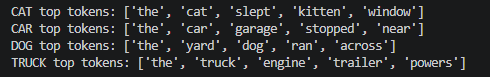
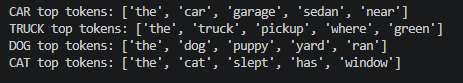
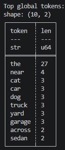
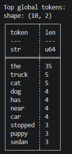
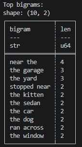
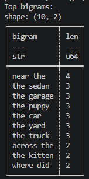
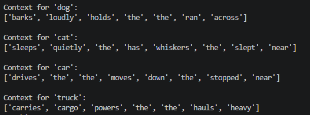
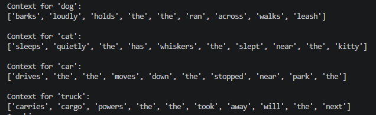

# Phases 4 & 5 Markdown File

Phase 4 asks for a modification on the example file, and Phase 5 asks for a custom application of the skills learned in this module.
That will be documented here. It is linked in both the project README.md file and the index.md file in the docs folder.

## Phase 4: Technical Modification

For my technical modification I increased the size of the corpus by making each category have four documents, or lines of text. Each sentence had either the category or a synonym for the category in it.

With the added text, the top tokens changed for the majority of the categories with the exception of the CAT category. Only one word changed while in the other categories the order of the words changed if not the word themselves. However, "the" stayed as the top token in all four categories.

Original Top Tokens

Phase 4 Top Tokens

The words in the top global tokens changed, again with the exception of the word "the" staying at the top.

Top 10 Global Tokens

Phase 4 Top 10 Global Tokens

The top bigrams moved around in the top 10, but most of them stayed in the top 10.

Top 10 Bigrams

Phase 4 Top Bigrams

The number of co-occurrences increased, which makes sense since there were more occurrences of the category since I added more documents to the corpus.

Co-Occurrences

Phase 4 Co-Occurrences

## Phase 5: Custom Application
